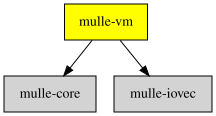

# mulle-vm

#### 🫧 User space virtual memory

A virtual memory system that runs in user space. Its beneficial when you are
writing an editor, which wants to edits huge files, as insertion and deletion
are comparatively super-fast. Reading and writing is very much slower though,
but the reasoning is, they are still fast enough for all editor purposes.

It's detrimental in read only situations.

A single instance of `struct mulle_vm` is not thread safe. If you need
threadsafe access you need to add locking code. However you can edit separate
`struct mulle_vm` instances in different threads, even when they contained
shared pages. This is relevant for copy/paste, where you might have put a
`struct mulle_vm` with "copy" contents on a pasteboard and then want to "paste"
it into a different `struct mulle_vm` in a different thread.


| Release Version                                       | Release Notes  | AI Documentation
|-------------------------------------------------------|----------------|---------------
|  [](//github.com/mulle-core/mulle-vm/actions) | [RELEASENOTES](RELEASENOTES.md) | [DeepWiki for mulle-vm](https://deepwiki.com/mulle-core/mulle-vm)


## Documentation & Guides

* [API Summary](asset/dox/api/toc)

# Mulle VM API Reference

The library version is defined as `MULLE__VM_VERSION` (major: 0, minor: 7, patch: 56).

## Setting Up a `mulle_vm` Instance

### 1. Include Headers

To use the Mulle VM API, include the main header:

```c
#include <mulle-vm/mulle-vm.h>
```

This pulls in necessary dependencies like `mulle-vm-page.h` and `mulle-vm-tree.h`.

### 2. Configuration

Configure the VM's memory management before initialization. Use the default config or customize it. The config controls page allocation, deallocation, page size, address skew (for hashing or alignment), and an optional shutdown callback.

Default configuration (`mulle_vm_config_default`):
- `alloc_pages`: NULL (falls back to `mulle_mmap_alloc_pages` for OS-level allocation).
- `free_pages`: NULL (falls back to `mulle_mmap_free_pages`).
- `shutdown`: NULL (no callback).
- `pagesize`: `MULLE__VM_PAGESIZE_DEFAULT` (0x4000, or 16KB).
- `skew`: `MULLE__VM_SKEW_DEFAULT` (25).
- `cachesize`: 0 (unused).

Example of custom configuration:

```c
struct mulle_vm_config config = mulle_vm_config_default;
config.pagesize = 0x8000;  // 32KB pages
config.skew = 30;          // Custom address skew
config.alloc_pages = my_custom_alloc;  // User-defined page allocator
config.free_pages = my_custom_free;    // User-defined page deallocator
config.shutdown = my_shutdown_callback;  // Called during mulle_vm_done
```

Note: Allocators must handle page-granular memory (e.g., allocate/free in multiples of `pagesize`). Standard `malloc/free` won't work due to alignment requirements.

### 3. Initialize the VM

Initialize a `struct mulle_vm` instance. Pass a custom config if needed; otherwise, use defaults. An allocator can be provided for internal structures (e.g., the tree and freed pages array).

```c
struct mulle_vm vm;
mulle_vm_init(&vm, NULL, NULL);  // Default config and system allocator
```

With custom config:

```c
mulle_vm_init(&vm, &config, my_allocator);  // Custom config and allocator
```

After init, the VM is ready: it has an empty tree for mappings and a pool for reused freed pages.

### 4. Cleanup

Release all resources, including pages and mappings. Calls the shutdown callback if set.

```c
mulle_vm_done(&vm);
```

To reset without full cleanup (keeps freed pages pool for reuse):

```c
mulle_vm_reset(&vm);
```

## Using the `mulle_vm` for Memory Management

The VM manages virtual address spaces as ranges (`struct mulle_range`: `{ uintptr_t location; size_t length; }`). Operations are efficient for sparse data.

### 1. Getting the Page Size

Retrieve the effective page size:

```c
size_t pagesize = mulle_vm_get_pagesize();  // Returns config.pagesize
```

If `vm` is NULL, returns default (0x4000).

### 2. Reading from the VM

Read a range into a buffer. Returns a pointer to the data: either direct VM memory (if contiguous in one page) or the provided buffer (if copied). Returns NULL on out-of-bounds or error.

```c
struct mulle_range range = { 0x1000, 1024 };  // Virtual address and length
void *buffer = malloc(range.length);
const void *data = mulle_vm_read(&vm, range, buffer);
if (data) {
    // Use data (may point to buffer or VM memory)
}
free(buffer);
```

For modifiable copy (always copies to buffer):

```c
void *modifiable_data = mulle_vm_read_copy(&vm, range, buffer);
```

### 3. Writing to the VM

Write data from a buffer to a virtual range. Overwrites existing data; allocates pages if needed. Returns pointer to written location or NULL on error.

```c
void *source_data = /* data to write */;
mulle_vm_write(&vm, range, source_data);
```

### 4. Inserting Data into the VM

Insert new data at a virtual range, shifting existing data if overlapping. Allocates pages as needed.

```c
void *new_data = /* bytes to insert */;
mulle_vm_insert(&vm, range, new_data);
```

To append at the end:

```c
mulle_vm_append(&vm, new_data, length);  // Appends after current total length
```

### 5. Deleting Data from the VM

Remove a range, evicting pages and shifting remaining data.

```c
mulle_vm_delete(&vm, range);
```

## Traversing Memory

Traverse virtual memory ranges with callbacks or enumerators.

### 1. Forward Traversal

Walk forward through a range, calling a callback for each contiguous segment.

Callback signature:

```c
int my_callback(struct mulle_data data, struct mulle_range vm_range, void *userinfo) {
    // data.bytes: pointer to content, data.length: size
    // vm_range: virtual address range
    return 0;  // Continue; non-zero to stop, negative for error
}
```

Usage:

```c
int result = mulle_vm_walk(&vm, range, my_callback, userinfo);
```

### 2. Reverse Traversal

Similar, but from high to low addresses:

```c
int result = mulle_vm_walk_reverse(&vm, range, my_callback, userinfo);
```

### 3. Enumerating Memory

Enumerate all nodes in the VM tree (forward):

```c
struct mulle_vm_enumerator enumerator = mulle_vm_enumerate(&vm);
struct mulle_vm_node *node;
while (mulle_vm_enumerator_next(&enumerator, (void **)&node)) {
    // node->page: physical page, node->address: virtual start
}
mulle_vm_enumerator_done(&enumerator);
```

Macro for convenience:

```c
mulle_vm_for(&vm, node) {
    // Process node
}
```

Reverse enumeration:

```c
struct mulle_vm_reverseenumerator rev_enum = mulle_vm_reverseenumerate(&vm);
while (mulle_vm_reverseenumerator_next(&rev_enum, (void **)&node)) {
    // Process node
}
mulle_vm_reverseenumerator_done(&rev_enum);
```

Macro:

```c
mulle_vm_for_reverse(&vm, node) {
    // Process node
}
```

## Advanced Operations

### 1. Copy Memory Range

Copy a range from source to destination VM (appends to dst, shares pages). Dst and src must differ.

```c
int err = mulle_vm_copy(&dst_vm, &src_vm, range);  // 0 on success
```

### 2. Cut Memory Range

Copy then delete from source:

```c
int err = mulle_vm_cut(&dst_vm, &src_vm, range);
```

### 3. Paste Memory Range

Delete dst range, then insert all from src there (shares pages):

```c
int err = mulle_vm_paste(&dst_vm, range, &src_vm);
```

## Statistics

Get VM stats:

```c
struct mulle_vm_statistics stats = mulle_vm_get_statistics(&vm);
// stats.vm_size: total virtual size
// stats.page_size: page size
```

## Example Code: Simple Text Editor Simulation

This example initializes two VMs, inserts text, copies a substring, and pastes it to replace parts—simulating basic editing:

```c
#include <mulle-vm/mulle-vm.h>
#include <string.h>
#include <stdio.h>

int main() {
    struct mulle_vm vm, copy;
    mulle_vm_init(&vm, NULL, NULL);
    mulle_vm_init(&copy, NULL, NULL);

    char text[] = "VfL Bochum 1848";
    struct mulle_range insert_range = { 0, strlen(text) };
    mulle_vm_insert(&vm, insert_range, text);

    // Copy "Bochum" (positions 4-9, length 6)
    struct mulle_range copy_range = { 4, 6 };
    mulle_vm_copy(&copy, &vm, copy_range);

    // Paste over "VfL" (0-2, length 3)
    struct mulle_range paste1 = { 0, 3 };
    mulle_vm_paste(&vm, paste1, &copy);

    // Paste over "1848" (14-17, length 4, but adjust for prior changes)
    struct mulle_range paste2 = { 10, 4 };  // After changes, end is at ~13, but demo assumes
    mulle_vm_paste(&vm, paste2, &copy);

    // Read and print result (expected: "Bochum Bochum")
    char buffer[32];
    struct mulle_range full = { 0, mulle_vm_get_length(&vm) };
    mulle_vm_read(&vm, full, buffer);
    printf("Result: %.*s\n", (int)full.length, buffer);

    mulle_vm_done(&copy);
    mulle_vm_done(&vm);
    return 0;
}
```

This demonstrates efficient sharing of pages between VMs during copy/paste. For production, add error checking.

### You are here




## Add

Use [mulle-sde](//github.com/mulle-sde) to add mulle-vm to your project:

``` sh
mulle-sde add github:mulle-core/mulle-vm
```

To only add the sources of mulle-vm with dependency
sources use [clib](https://github.com/clibs/clib):


``` sh
clib install --out src/mulle-core mulle-core/mulle-vm
```

Add `-isystem src/mulle-core` to your `CFLAGS` and compile all the sources that were downloaded with your project.


## Install

Use [mulle-sde](//github.com/mulle-sde) to build and install mulle-vm and all dependencies:

``` sh
mulle-sde install --prefix /usr/local \
   https://github.com/mulle-core/mulle-vm/archive/latest.tar.gz
```

### Legacy Installation

#### Requirements

Preferably install mulle-core and be done with it:

| Requirements                                     | Description
|--------------------------------------------------|-----------------------
| [mulle-core](//github.com/mulle-core/mulle-core) |🌋 Almagamated library of mulle-core + mulle-concurrent + mulle-c


Or if you really want to do it exhaustively:

| Requirements                                 | Description
|----------------------------------------------|-----------------------
| [mulle-core](https://github.com/mulle-core/mulle-core)             | 🌋 Amalgamated library of mulle-core + mulle-concurrent + mulle-c
| [mulle-iovec](https://github.com/mulle-core/mulle-iovec)             | 🧺 cross-platform scatter/gather I/O for files and pipes (readv/writev emulation)

#### Download & Install

Download the latest [tar](https://github.com/mulle-core/mulle-vm/archive/refs/tags/latest.tar.gz) or [zip](https://github.com/mulle-core/mulle-vm/archive/refs/tags/latest.zip) archive and unpack it.

Install **mulle-vm** into `/usr/local` with [cmake](https://cmake.org):

``` sh
PREFIX_DIR="/usr/local"
cmake -B build                               \
      -DMULLE_SDK_PATH="${PREFIX_DIR}"       \
      -DCMAKE_INSTALL_PREFIX="${PREFIX_DIR}" \
      -DCMAKE_PREFIX_PATH="${PREFIX_DIR}"    \
      -DCMAKE_BUILD_TYPE=Release &&
cmake --build build --config Release &&
cmake --install build --config Release
```


## Author

[Nat!](https://mulle-kybernetik.com/weblog) for Mulle kybernetiK  


